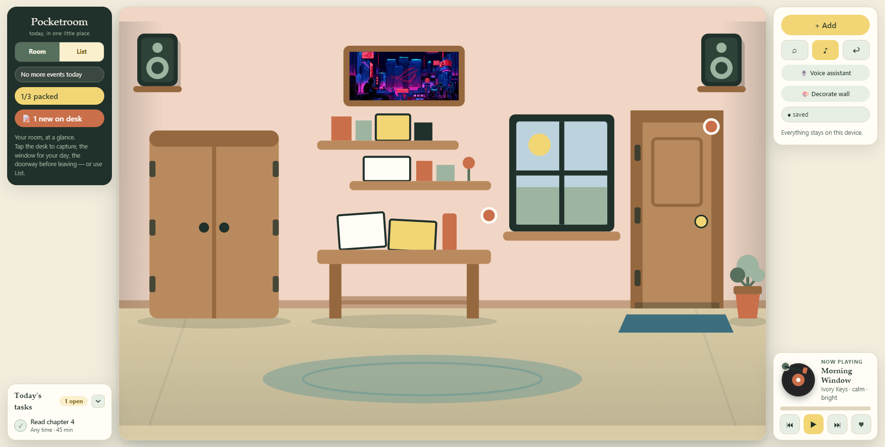
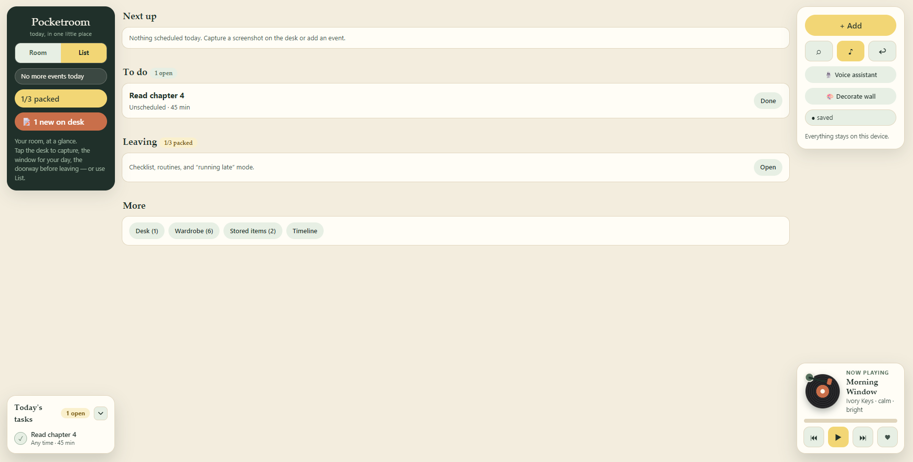

# Pocketroom — Today's Room

> Everything you need for today, in one little place. A cozy, local-first day planner
> with a room you can see, a voice you can talk to, and a plan that respects your time.

## Live Demo

- **Hosted:** https://anuranjanjain.github.io/MetaAI2026/ (auto-deploys from `main`
  via GitHub Actions)
- **Local:** `http://127.0.0.1:5173/` (`npm run dev`)

## Screenshots

| Homepage (Room) | List page |
|---|---|
|  |  |

More screenshots (planner, wardrobe photo) coming soon.

## What it does

- **Today's Room** — a hand-built SVG scene (wardrobe, desk, staggered shelves, in-wall
  window + door, plant, stereo speakers, posters including your own uploaded poster)
  that reflects your actual day. Full-height frame, no page scroll.
- **Voice assistant** 🎙️ — say it, confirm it. *"Dentist tomorrow at 2:30 pm"*,
  *"remind me to buy milk"*, *"where is my adapter?"*, *"what's next?"* — intents are
  classified on-device, missing details are asked by voice, and **nothing is ever
  saved or completed without your tap**. Spoken read-back on confirm.
- **Action planner** — "Plan my day" turns fixed events + flexible tasks into a
  reviewable step list: fixed plans stay fixed, tasks slot into free windows, a prep
  step per event (unpacked checklist items), an honest leave-by buffer
  (*"not a travel time"*), and an *"I'm late — replan from now"* mode that defers
  what no longer fits instead of silently dropping it. Accept applies everything in
  one undoable update.
- **Desk captures** — drop a note or screenshot; an on-device interpretation proposes
  a task/event/item, you edit and confirm. Every proposal path shows its honesty label.
- **Wardrobe + photos** — catalog your clothes, then "Add from photo": upload a
  wardrobe picture, tap Detect for live Muse drafts (live mode only, explicit
  tap) or hand-tag the pieces yourself, confirm only what you want.
  Event-aware outfit suggestions (*"Today — from your events"*).
- **Storage spots** — every belonging has a last-recorded spot; ambiguous matches are
  shown, never guessed.
- **Record player** 🎵 — eight original WebAudio synth loops (no files, no network,
  no account) with a spinning vinyl, tonearm that swings in on play, progress bar,
  and favorites.
- **Honest by design** — demo heuristics are labelled
  (*"Demo interpretation — on-device heuristics, no model call"*), transcripts and
  model-style outputs are treated as untrusted input, and deterministic rules
  (scheduling bounds, fixed-event protection, confirmations) stay in app code.

## Tech stack

| Layer | Choice |
|---|---|
| Build | Vite 6 + TypeScript (strict, `tsc --noEmit`) |
| UI | No framework — DOM via template strings + event wiring, SVG room scene |
| State | Single `AppState` store, `localStorage` key `pocketroom.v1`, undo stack (30) |
| Voice in/out | Browser Web Speech API (`SpeechRecognition` + `speechSynthesis`), feature-detected |
| Music/SFX | WebAudio — synthesized loops + UI motifs, zero audio files |
| Images | Canvas-downscaled JPEG data URLs (quota-safe local persistence) |
| Tests | `node:test` + `tsx` — 152 tests, pure logic in `src/core/` |
| Backend (optional) | Vercel serverless proxy (`api/interpret.ts`) → Muse API (`muse-spark-1.3`), key in Vercel server secret only |

## Usage

Prereqs: Node 18+.

```bash
npm install
npm run dev      # http://127.0.0.1:5173 — localhost is a secure context, so the mic works here
npm test         # 152 tests across assistant / planner / wardrobe / scheduling / live adapter
npm run build    # tsc --noEmit && vite build → dist/
npm run preview  # serve the production build locally
```

Notes:

- Voice features need Chrome/Edge (Firefox has no speech recognition — the mic button
  hides itself and typing always works). Mic permission denied → graceful toast.
- Your data never leaves the device. No accounts, no tracking, no network calls
  in the local build. Clearing site data wipes the room.
- Cloud AI stays fully optional: use your own Muse key in-app (BYOK, stored
  only in your browser), or the hosted proxy via a `localStorage` opt-in
  (`pocketroom.liveMuse`) plus a `VITE_MUSE_PROXY_URL` build secret. If no
  key path works, the app silently uses the complete local product. The
  shared Muse key lives only in the Vercel dashboard — never the repo or
  bundle (see `docs/integrations.md`).

## Project structure

```
src/
  core/        # pure, node-testable logic: assistant, planner, inference,
               # schedule, wardrobeVision, model, types
  views/       # room scene, desk, timeline, wardrobe, storage, assistant sheet
  shell.ts     # frame: rails, docks, sheets, toasts (keep under ~500 lines)
  voice.ts     # speech in/out wrappers      image.ts      # upload validation + downscale
  music.ts     # synth player                audio.ts      # UI sound motifs
  store.ts     # single store + undo         styles.css    # full-height frame + rails
tests/         # assistant, planner, wardrobe, scheduling suites
docs/          # integrations.md (honesty contract), screenshots/
api/           # Vercel proxy: transcript → Muse intent (key in Vercel secret only)
```

Conventions: pure logic lives in `src/core/`; views never mutate the store except
through editable-confirm → validate → single `store.update`; all new persisted
fields are optional so old saves keep loading.

## Contributing

1. Fork the repo and create a branch (`git checkout -b my-change`).
2. Keep files under 500 lines; put testable logic in `src/core/`.
3. Never invent endpoints, model IDs, or prices — unverified stays unwired
   (see `docs/integrations.md`).
4. Gate before every PR: `npm run build` and `npm test` fully green.
5. Open a PR against `main` with what changed and how you tested it.

## License

MIT — see [LICENSE](LICENSE). Do anything you like with it; a shout-out is appreciated.

## Made with love by [Anuranjan Jain](https://github.com/AnuranjanJain)

Cozy software for hectic days. 🏠
