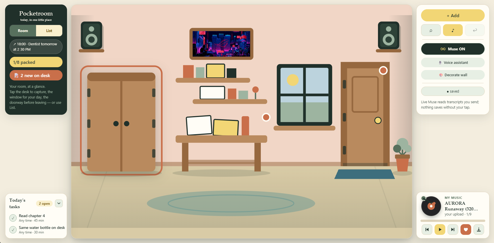
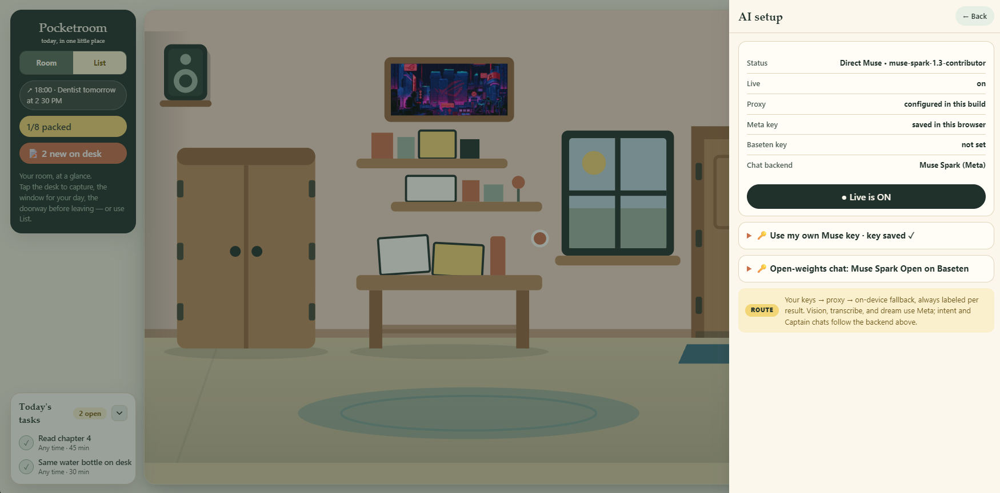
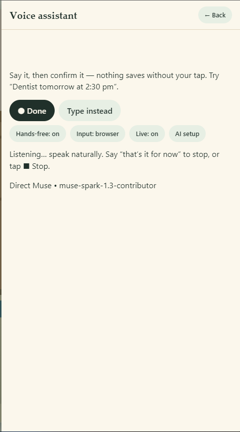
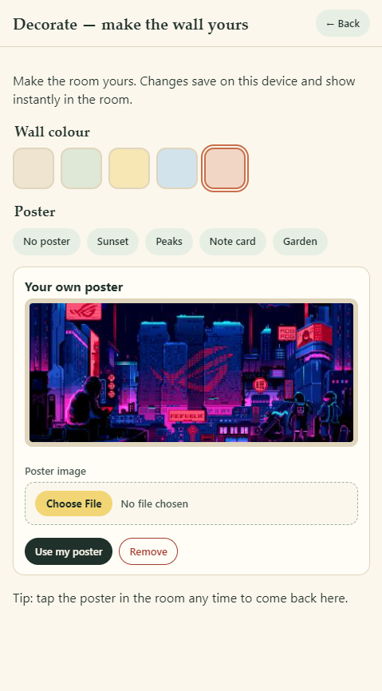
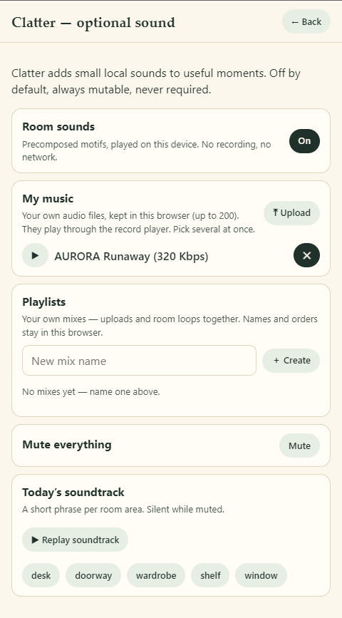
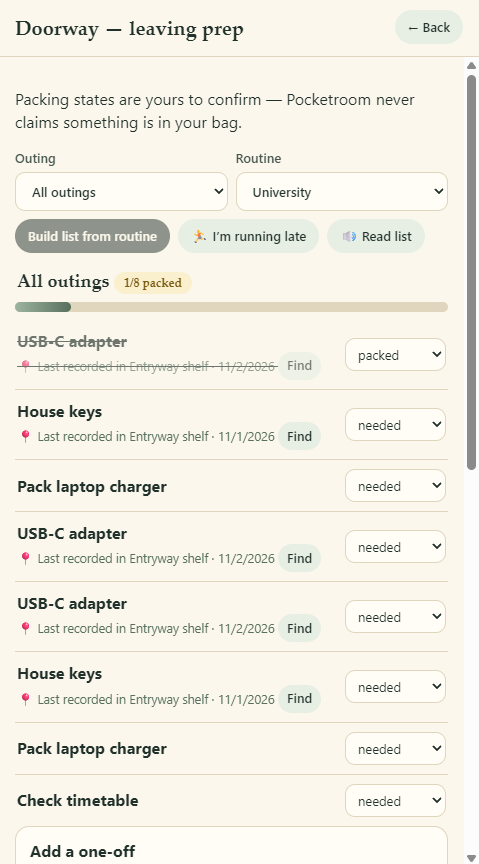
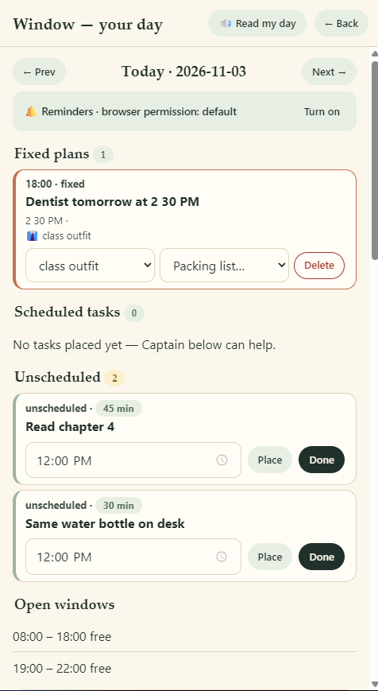
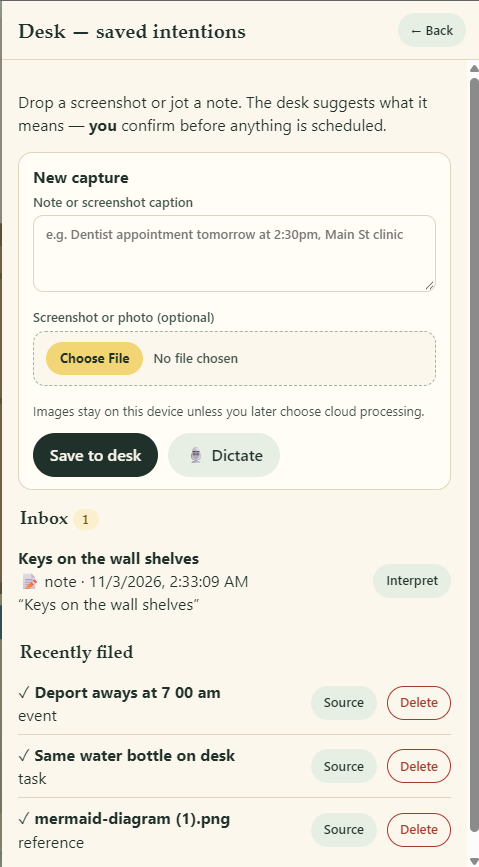

<p align="center">
  
</p>

<h1 align="center">Pocketroom</h1>

<p align="center"><em>Everything you need for today, in one little place.</em></p>

<p align="center">
  <a href="https://pocketroom-six.vercel.app/"></a>
  <a href="https://youtu.be/LaiRvqQhgWE"></a>
  
  
  
</p>

<p align="center">A cozy, local-first day planner with a room you can see, a voice you can talk to,<br/>and a plan that respects your time. Nothing ever saves without your tap. ♡</p>

<p align="center">♡ ♡ ♡</p>

## Screenshots

<table>
  <tr>
    <td width="50%"><br /><em>Today's Room — rails, room, tasks, record player</em></td>
    <td width="50%"><br /><em>AI setup — one home for keys, backend and Live</em></td>
  </tr>
  <tr>
    <td width="50%"><br /><em>Voice assistant — say it, then confirm it</em></td>
    <td width="50%"><br /><em>Decorate — wall colours, posters, your own art</em></td>
  </tr>
  <tr>
    <td width="50%"><br /><em>Clatter — room sounds, uploads and mixes</em></td>
    <td width="50%"><br /><em>Doorway — pack by routine before you leave</em></td>
  </tr>
  <tr>
    <td width="50%"><br /><em>Window — plans, tasks and Morning Captain</em></td>
    <td width="50%"><br /><em>Desk — captures in, confirmed plans out</em></td>
  </tr>
</table>

<p align="center">♡ ♡ ♡</p>

## What it does

**Today's Room** — a hand-built SVG scene (wardrobe, desk, shelves, window,
door, plant, stereo, posters including your own uploads) that mirrors your
actual day. Side rails on desktop, a tidy two-row app bar on phones and
tablets, and a late-night mode when the day runs long.

**Voice assistant** — say it, confirm it. *"Dentist tomorrow at 2:30 pm"*,
*"remind me to buy milk"*, *"where is my adapter?"* — understood via Live
Muse or on-device heuristics, with browser or Muse Voice Transcribe input,
hands-free mode, missing details asked by voice, spoken read-back on
confirm, and a per-result model + latency line. Nothing is ever saved or
completed without your tap.

**Morning Captain** — dump the day in one textarea; Muse (Wonder-first,
Spark fallback) proposes slots, prep, leave-by, outfit and pack list; app
code verifies it (fixed events never move, no invented ids, no overlaps);
one tap accepts everything undoably and bumps your streak. Includes a demo
day for first-run judges and an *"I'm late — replan from now"* mode.

**Desk captures** — drop a note or screenshot, or dictate one; instant
on-device reading plus an "Interpret with Muse" tap for model extraction.
Every proposal ends in a confirm-before-creating card: confirm, archive, or
discard — the box always clears. Voice-style times (*"at 7 00 am"*) parse
correctly, never as midnight.

**Window day view** — Prev/Next day stepping, fixed plans, scheduled and
unscheduled tasks with place / done / unschedule, open windows, an action
planner with honest leave-by buffers, local reminders with notifications,
a read-my-day button pinned in the header, plus overdue rescue and
carry-forward when days slip.

**Wardrobe** — catalog your clothes, then "Add from photo": live Muse
vision drafts with SAM 3.1 segmentation, or hand-tag pieces yourself —
confirm only what you keep. Occasion ideas and event-aware outfit picks
come strictly from available items.

**Doorway, shelf, search** — pack by routine before leaving (with a running
late mode and a read-aloud list), belongings with last-recorded spots, and
natural-language search (*"where did I put the adapter?"*) that shows
ambiguous matches instead of guessing.

**Record player + mixes** — eight original WebAudio synth loops (no files,
no network) on a spinning vinyl with a swinging tonearm, plus your own
uploads (up to 200, multi-select, kept in IndexedDB) and named playlists
mixing uploads with loops, persisted in your browser. Favorites, transport
controls, tap-the-disk to open your mixes.

**Clatter + soundtrack** — tiny local motifs for useful moments (off by
default, always mutable, never required), a per-area soundtrack with replay,
and one mute that hushes everything.

**Decorate** — wall colours, builtin posters, or your own poster upload.
Changes save on-device and show instantly in the room.

**Share your day** — an on-device SVG day poster (headlines auto-fit, never
clip), an optional Muse Image dream upgrade, PNG download, SVG download,
Post-to-X, and copyable share text with real counts.

**AI setup, one home** — Live proxy, your own Muse key (stored only in your
browser), or open-weights Spark on Baseten; provider picker, Live toggle,
per-path status and routing notes. Every live result names its path and
model; every fallback says so out loud.

**Honest by design** — demo heuristics wear a `DEMO` sticker, live results
wear `MUSE ON`, transcripts and model output are treated as untrusted
input, and deterministic rules (scheduling bounds, fixed-event protection,
confirmations) stay in app code. See `docs/integrations.md` for the full
honesty contract.

**Everywhere a day happens** — phone sheet stacking, a tablet tasks+player
duo with an ordered app bar, desktop side rails and corner docks,
coarse-pointer and safe-area CSS, and a PWA-lite shell (manifest, icon,
offline service worker) so the room opens like an app.

<p align="center">♡ ♡ ♡</p>

## Tech stack

| Layer | Choice |
|---|---|
| Build | Vite 6 + TypeScript (strict, `tsc --noEmit`) |
| UI | No framework — DOM via template strings + event wiring, SVG room scene |
| State | Single `AppState` store, `localStorage` key `pocketroom.v1`, undo stack (30) |
| Voice in/out | Browser Web Speech API or Muse Voice Transcribe (`muse-voice-transcribe-1.0`) + `speechSynthesis`, feature-detected |
| Music/SFX | WebAudio — synthesized loops + UI motifs, zero audio files; uploads in IndexedDB, playlists in `localStorage` |
| Images | Canvas-downscaled JPEG data URLs (quota-safe); Muse Image (`muse-image-1.0`) dream poster; SAM 3.1 photo segmentation |
| Models | Muse Spark (`muse-spark-1.3-contributor`), Muse Wonder (`muse-wonder-1.0`) for Captain, Spark Open on Baseten (`meta-models/muse-spark-open-1026`) |
| Tests | `node:test` + `tsx` — 228 tests, pure logic in `src/core/` |
| Backend | Vercel serverless proxy (`api/*.ts`: interpret, propose, tag-photo, captain, wonder-captain, transcribe, dream, sam-segment) → Meta Model API, key in a Vercel server secret only |

## Usage

Prereqs: Node 18+.

```bash
npm install
npm run dev      # http://127.0.0.1:5173 — localhost is a secure context, so the mic works here
npm test         # 228 tests: inference, assistant, planner, captain, transcribe, dream, share, music, playlists, wardrobe, scheduling, live adapter…
npm run build    # tsc --noEmit && vite build → dist/
npm run preview  # serve the production build locally
```

Notes:

- **Live demo:** https://pocketroom-six.vercel.app/ (redeploys from `main`).
- Voice features need Chrome/Edge (Firefox has no speech recognition — the mic
  button hides itself and typing always works). Mic permission denied →
  graceful toast. Muse Transcribe input needs a mic + a Live path (proxy or
  your own key).
- Your data stays on-device except transcripts/audio/day-words you explicitly
  send to Muse when Live is on. No accounts, no tracking. Clearing site data
  wipes the room.
- Live Muse is ON by default when the build carries `VITE_MUSE_PROXY_URL`
  (same-origin `/api/*` on Vercel; set the var explicitly for other hosts);
  turn it off any time (assistant Live toggle sets `pocketroom.liveMuse`).
  Or bring your own Muse key in-app (BYOK, stored only in your browser).
  If no key path works, the app runs the complete local product with a
  visible fallback label — never silent. The shared Muse key lives only in
  the Vercel dashboard — never the repo or bundle (see `docs/integrations.md`).

## Project structure

```
src/
  core/        # pure, node-testable logic: assistant, byok, captain, dream,
               # inference (voice-time + place parsing), liveModel, model,
               # muse (endpoints + shortModel), openweights, planner,
               # sam (segmentation), schedule, share (poster + fitLine),
               # transcribe, types, wardrobeVision
  views/       # room scene, assistant, share, setup, key sheets
  views/areas/ # desk, doorway, storage, timeline (window), wardrobe
  shell.ts     # frame: rails, docks, sheets, toasts, decor + clatter panels
  voice.ts     # speech in/out wrappers      image.ts      # upload validation + downscale
  audioRecord.ts # mic clip → WAV for Muse Transcribe
  music.ts     # synth player + uploads + playlists
  audio.ts     # UI sound motifs             store.ts      # single store + undo
  styles.css   # full-height frame, rails, sheets, responsive tiers
tests/         # 22 suites incl. inference, liveModel, music, share, wardrobe
docs/          # integrations.md (honesty contract), screenshots/, images/
api/           # Vercel proxy → Meta Model API (key in Vercel secret only)
public/        # PWA manifest, icon, offline service worker
```

Conventions: pure logic lives in `src/core/` and is covered by tests; views
never mutate the store except through editable-confirm → validate → single
`store.update`; all new persisted fields are optional so old saves keep
loading; every user-words line on the poster goes through `fitLine` so
nothing ever clips.

## Contributing

1. Fork the repo and create a branch (`git checkout -b my-change`).
2. Keep files under 500 lines; put testable logic in `src/core/`.
3. Never invent endpoints, model IDs, or prices — unverified stays unwired
   (see `docs/integrations.md`).
4. Gate before every PR: `npm run build` and `npm test` fully green.
5. Open a PR against `main` with what changed and how you tested it.

## License

MIT — see [LICENSE](LICENSE). Do anything you like with it; a shout-out is appreciated.

## Made with love by [Anuranjan Jain](https://github.com/AnuranjanJain)

<p align="center">Cozy software for hectic days. 🏠</p>
